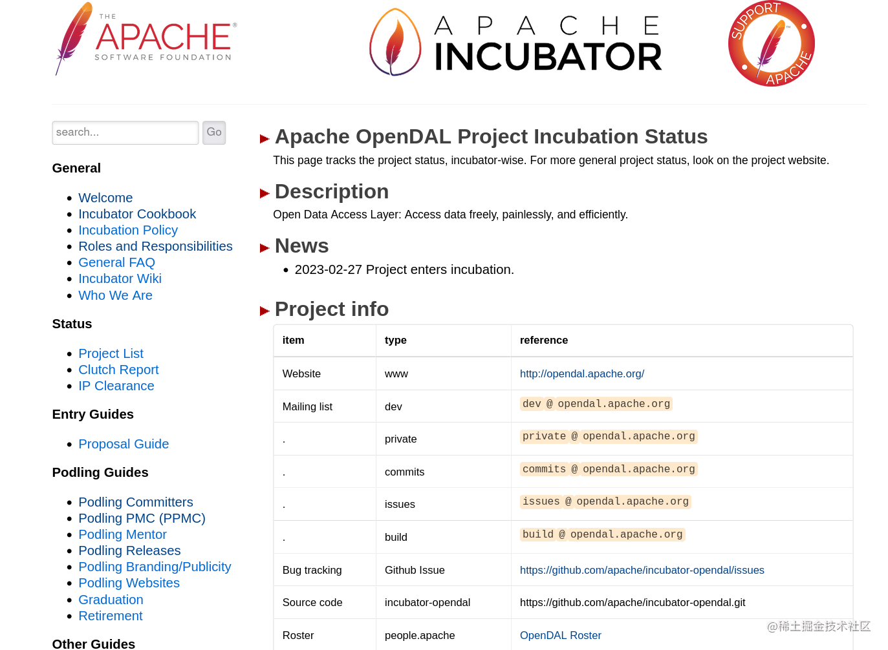
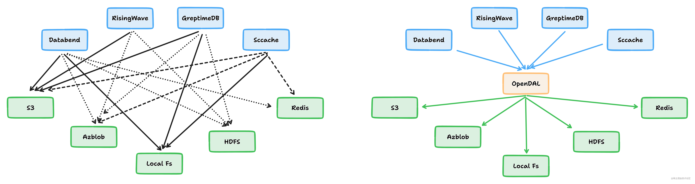
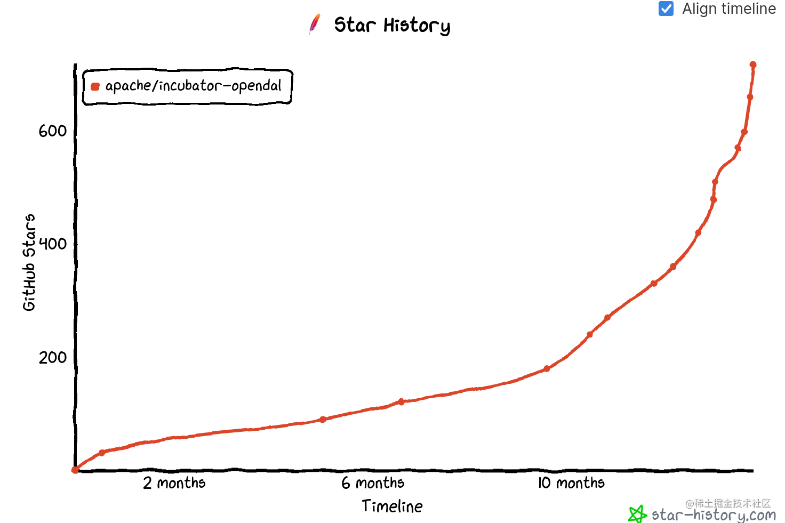

+++
title = "Announcement: OpenDAL Enters the Apache Incubator"
description = "OpenDAL passed the vote on February 27, 2023 and entered the Apache Incubator. This is the Chinese article, translated for this archive."
date = 2023-03-17
slug = "opendal-enters-apache-incubator"

[taxonomies]
tags = ["2023", "ASF", "OpenDAL", "Archive"]

[extra]
lang = "en"
source_url = "https://juejin.cn/post/7211327163702018104"
source_note = "English translation of the Chinese original, first published on 2023-03-17. Source: "
source_label = "Juejin original"
source_tail = ". This translation was prepared for this archive."
+++

> Author: PsiACE
>
> Databend R&D Engineer [github.com/PsiACE](https://github.com/PsiACE)

On February 27, 2023, the [OpenDAL](https://github.com/apache/incubator-opendal) project successfully passed the vote and formally entered the Incubator of the [Apache Software Foundation](https://www.apache.org/) (ASF), the world's top open-source software foundation, becoming an ASF incubating project (podling). On March 15, the OpenDAL project was officially transferred under the Apache Software Foundation.

This is an important milestone for the [Databend](https://github.com/datafuselabs/databend) team in the open-source community, and also a recognition and endorsement by the open-source community of OpenDAL's technology and philosophy.

> The Apache Incubator was founded in October 2002. It provides a path into the Apache Software Foundation for projects and codebases that want to become part of the Apache Foundation's efforts. Incubating projects are expected to practice ASF governance and operations and to use the infrastructure and resources provided by ASF. An incubating project has to go through a series of stages and evaluations before it can finally graduate and become an ASF top-level project (TLP).

[incubator.apache.org/projects/op…](https://incubator.apache.org/projects/opendal.html)

## What Is OpenDAL

Data is one of the most important assets of the future, and data access is the key link in realizing the value of data.

A wide variety of storage services exist on the market, and each service has its own unique interfaces and characteristics, which brings a lot of complexity and inconvenience to data access.

OpenDAL provides a unified, simple, efficient, reliable, and observable data access layer, so that developers can seamlessly use different storage services and enjoy the best user experience.

OpenDAL not only simplifies the interfaces of different storage services, but also provides features such as automatic retry, request optimization, and observability. Developers only need to use OpenDAL to painlessly access dozens of storage services, without having to understand and master the details of specific SDKs.

**OpenDAL's features include but are not limited to:**

- Support for a wide range of storage services, including the local file system, HDFS, S3, OSS, and dozens of other services.
- A unified data access interface, so there is no need to care about underlying storage details.
- Support for a variety of common data operations, including `read` , `write` , `list` , and so on.
- Support for automatic retry, request optimization, and observability mechanisms.
- Zero cost, mapping directly to API calls.
- Cross-language bindings: Python, Node.js, C (working on), and so on.

## OpenDAL's History, Development, and Current State

### *History: From dal2 to OpenDAL*

The original intent of OpenDAL was to build a general-purpose, unified, and easy-to-use data access layer. It was born at the end of 2021, and at first it was developed as part of the Databend project.

- On December 21, 2021, [Xuanwo](http://github.com/Xuanwo) began to conceive the design and implementation of Databend's storage access layer, [dal2: Add basic operations of read, write, stat, delete](https://github.com/datafuselabs/databend/pull/3575)
- On December 27, 2021, discussion began on the proposal [proposal: Vision of Databend DAL](https://github.com/datafuselabs/databend/discussions/3662). On the 29th, the implementation of dal2 was merged into Databend.
- On February 14, 2022, dal2 was formally moved out of the Databend code repository, became an independently maintained top-level project, and was formally renamed OpenDAL .

### *Development: From 1 to +1*

Driven by Xuanwo , [ClSlaid](https://github.com/ClSlaid) and many other contributors, OpenDAL quickly became a data access layer supporting mainstream domestic and international storage services such as AWS S3 / Azure Blob / GCS / HDFS, and provided Databend's `COPY INTO`, Stage, and Storage with genuine cross-multi-cloud cloud-native storage and access support.

[GreptimeDB](https://github.com/GreptimeTeam/greptimedb) was the first large Rust database project to proactively adopt OpenDAL after Databend. Afterwards, through Xuanwo's efforts, [sccache](https://github.com/mozilla/sccache) under the Mozilla Foundation also tried to use OpenDAL to take over its storage layer; to provide more comprehensive support, OpenDAL soon shipped support for GitHub Action Cache.

Then came [RisingWave](https://github.com/risingwavelabs/risingwave) and [Vector ](https://github.com/vectordotdev/vector), and OpenDAL's user base began the shift from 1 to an ever-growing +1.

### *Current State: Marching Toward the Sea of Stars*

OpenDAL has now initially built a small community and formed a product matrix. In addition to the [Rust](https://crates.io/crates/opendal) main code, [Python](https://pypi.org/project/opendal/) and [Nodejs](https://www.npmjs.com/package/opendal) bindings are currently provided.

Since it was open-sourced, OpenDAL has made 99 releases in total, with Github Star 700+, cumulative downloads of 349 K, and 48 contributors in total. The project has remained actively updated, and we sincerely thank every contributor for their effort and dedication.

Joining the Apache Incubator is an important milestone in OpenDAL's development history. We hope to use the ASF platform and resources to let OpenDAL focus on providing a neutral, vendor-lock-in-free, free, painless, and efficient storage access layer, and to serve the wider developer community better.

We look forward to OpenDAL being applied more widely in the following scenarios:

- Data analysis: OpenDAL can help data analysts quickly read from or write to different storage services, and perform various format conversions and operations.
- Data science: OpenDAL can help data scientists easily obtain or save data from different storage services, and perform various preprocessing and postprocessing.
- Data engineering: OpenDAL can help data engineers efficiently build and manage data pipelines between different storage services, and perform various monitoring and tuning.

## Acknowledgements

*From Xuanwo*

Hello everyone, I am Xuanwo, an Apache OpenDAL Committer.

The OpenDAL project embodies a dream I have always held personally, and now, with the community's concerted efforts, it has entered the Apache Incubator. I feel very happy at this moment. Thanks to all contributors for their dedication, thanks to Databend Labs for its support, thanks to Champion tison for his guidance, and thanks to Mentors ningjiang, wusheng, tedliu, and hexiaoqiao for their guidance.

Let us follow the guidance of the Apache Way, build the community together and create value, and provide users with a free, painless, and efficient data access experience!

## Join Us

Developers and users interested in contributing to the OpenDAL project are welcome to join the OpenDAL community and follow the latest news about OpenDAL. You can get more information in the following ways:

- Visit the OpenDAL official website: [opendal.apache.org](https://opendal.apache.org/)
- Explore the OpenDAL GitHub repository: [github.com/apache/incu…](https://github.com/apache/incubator-opendal)
- Join the OpenDAL Discord channel: [discord.gg/XQy8yGR2dg](https://discord.gg/XQy8yGR2dg)
- Subscribe to the OpenDAL mailing list: [dev@opendal.apache.org](mailto:dev@opendal.apache.org)
