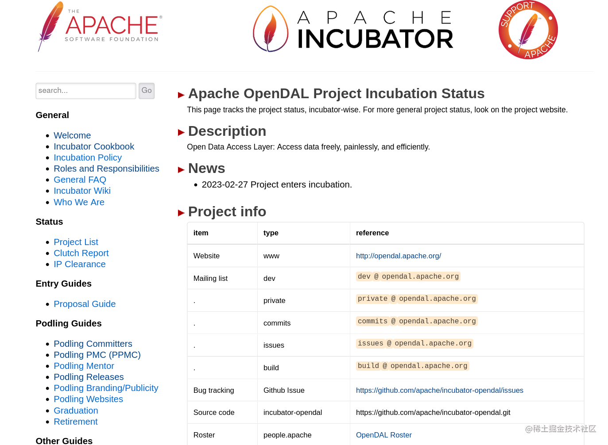
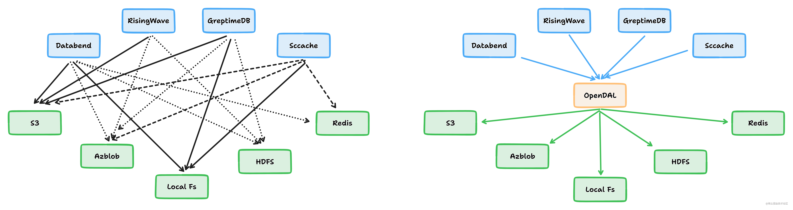
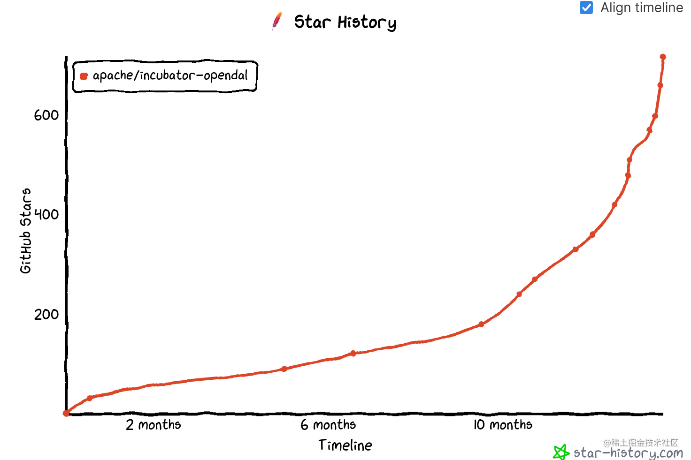

+++
title = "官宣：OpenDAL 成功进入 Apache 孵化器"
description = "OpenDAL 于 2023 年 2 月 27 日通过投票，正式进入 Apache 孵化器。本文为掘金原文归档。"
date = 2023-03-17
slug = "opendal-enters-apache-incubator"

[taxonomies]
tags = ["2023", "ASF", "OpenDAL", "归档"]

[extra]
lang = "zh"
source_url = "https://juejin.cn/post/7211327163702018104"
source_note = "本文原发于 2023-03-17："
source_label = "掘金原文"
source_tail = "。此处为存档版本，正文按原文照录。"
+++

> 作者：PsiACE
>
> Databend 研发工程师 [github.com/PsiACE](https://github.com/PsiACE)

2023 年 2 月 27 日，[OpenDAL](https://github.com/apache/incubator-opendal) 项目顺利通过投票，正式进入全球顶级开源软件基金会 —— [Apache 软件基金会](https://www.apache.org/)（ASF）的孵化器（Incubator），成为 ASF 的一个孵化项目（podling）。在 3 月 15 日，OpenDAL项目正式移交到 Apache 软件基金会名下。

这是 [Databend](https://github.com/datafuselabs/databend) 团队在开源社区的一个重要里程碑，也是开源社区对 OpenDAL 的技术和理念的一次认可和支持。

> Apache 孵化器成立于 2002 年10月，为那些意图成为 Apache 基金会努力的一部分的项目和代码库，提供一个进入到 Apache 软件基金会的路径。孵化器项目需要践行 ASF 的治理和运营方式，并使用 ASF 提供的基础设施和资源。孵化器项目需要经过一系列的阶段和评估，才能最终毕业成为 ASF 的顶级项目（TLP）。

[incubator.apache.org/projects/op…](https://incubator.apache.org/projects/opendal.html)

## 什么是 OpenDAL

数据是未来最重要的资产之一，而数据访问是数据价值实现的关键环节。

市场上存在着各种各样的存储服务，每个服务都有自己独特的接口和特性，给数据访问带来了很多复杂性和不便。

OpenDAL 提供一个统一、简单、高效、可靠、可观察的数据访问层，让开发者可以无缝地使用不同的存储服务，并享受到最佳的用户体验。

OpenDAL 不仅简化了不同存储服务的接口，还提供自动重试、请求优化和可观察性等特性。开发者只需要使用 OpenDAL 就可以无痛访问数十种存储服务，而无需了解和掌握特定 SDK 的细节。

**OpenDAL 的特性包括但不限于：**

- 支持多种存储服务，包括本地文件系统、HDFS、S3、OSS 数十种服务等。
- 提供统一的数据访问接口，无需关心底层存储细节。
- 支持多种常用数据操作，包括 `read` 、`write` 、`list` 等。
- 支持自动重试、请求优化、可观察性机制。
- 零成本，直接映射到 API 调用。
- 跨语言 bindings: Python, Node.js, C (working on) 等

## OpenDAL 的历史、发展与现状

### *历史：从 dal2 到 OpenDAL*

OpenDAL 的初衷是打造一个通用、统一、易用的数据访问层，它诞生于 2021 年末，最开始是作为 Databend 项目的一部分进行开发的。

- 2021 年 12 月 21 日，[Xuanwo](http://github.com/Xuanwo) 开始着手构想 Databend 存储访问层的设计与实现，[dal2: Add basic operations of read, write, stat, delete](https://github.com/datafuselabs/databend/pull/3575)
- 2021 年 12 月 27 日，开始对 [proposal: Vision of Databend DAL](https://github.com/datafuselabs/databend/discussions/3662) 这一提案的讨论。29 日，dal2 的实现被合并到 Databend 中。
- 2022 年 2 月 14 日，dal2 正式从 Databend 的代码仓库中迁出，成为独立维护的顶级项目，并正式更名为 OpenDAL 。

### *发展：从 1 到 +1*

在 Xuanwo 、[ClSlaid](https://github.com/ClSlaid) 和其他众多贡献者的推动下，OpenDAL 很快就成为了支持 AWS S3 / Azure Blob / GCS / HDFS 等主流国内外存储服务的数据访问层，并为 Databend 的 `COPY INTO`、Stage、Storage 提供真正的跨多云云原生存储与访问支持。

[GreptimeDB](https://github.com/GreptimeTeam/greptimedb) 是 Databend 之后第一个主动使用 OpenDAL 的大型 Rust 数据库项目，之后，在 Xuanwo 的努力下，Mozilla 基金会旗下的 [sccache](https://github.com/mozilla/sccache) 也尝试使用 OpenDAL 来接管存储层，为了提供更全面的支持，OpenDAL 很快上线了对 GitHub Action Cache 的支持。

随后是 [RisingWave](https://github.com/risingwavelabs/risingwave) 和 [Vector ](https://github.com/vectordotdev/vector)，OpenDAL 的用户阵营开始实现从 1 到不断 +1 的转变。

### *现状：向星辰大海前进*

目前 OpenDAL 已初步建立起了一个小型社区并形成产品矩阵，除 [Rust](https://crates.io/crates/opendal) 主代码以外，目前还提供有 [Python](https://pypi.org/project/opendal/) 和 [Nodejs](https://www.npmjs.com/package/opendal) 绑定。

OpenDAL 自开源以来累计发版 99 次，Github Star 700+, 累计下载次数 349 K, 累计开发者共计 48 位，项目一直处于活跃更新状态，由衷感谢每位贡献者的努力和付出。

加入 Apache 孵化器是 OpenDAL 发展历程中的一个重要里程碑，我们希望能够借助 ASF 的平台和资源，让 OpenDAL 专注于提供中立、无供应商锁定、自由、无痛、高效的存储访问层，更好地为广大开发者服务。

我们期待 OpenDAL 能够在以下几个应用场景得到更广泛的应用：

- 数据分析：OpenDAL 可以帮助数据分析师快速地从不同的存储服务中读取或写入数据，并进行各种格式转换和操作。
- 数据科学：OpenDAL 可以帮助数据科学家轻松地从不同的存储服务中获取或保存数据，并进行各种预处理和后处理。
- 数据工程：OpenDAL 可以帮助数据工程师高效地构建和管理不同的存储服务之间的数据流水线，并进行各种监控和调优。

## 致谢

*From Xuanwo*

大家好，我是 Apache OpenDAL Committer Xuanwo。

OpenDAL 项目凝聚着我个人一直以来的梦想，如今在社区的通力协作下走进了 Apache 孵化器，我此刻感到非常的幸福。感谢所有贡献者的付出，感谢 Databend Labs 的支持，感谢 Champion tison 的指引，感谢各位 Mentor ningjiang, wusheng, tedliu 和 hexiaoqiao 的指导。

让我们遵循 Apache Way 的指引，共同构建社区并创造价值，为用户提供自由、无痛和高效的数据访问体验！

## 加入我们

欢迎有兴趣参与 OpenDAL 项目的开发者和用户加入 OpenDAL 社区，并关注 OpenDAL 的最新动态。你可以通过以下方式获取更多信息：

- 访问 OpenDAL 官方网站：[opendal.apache.org](https://opendal.apache.org/)
- 探索 OpenDAL GitHub 仓库：[github.com/apache/incu…](https://github.com/apache/incubator-opendal)
- 加入 OpenDAL Discord 频道：[discord.gg/XQy8yGR2dg](https://discord.gg/XQy8yGR2dg)
- 订阅 OpenDAL 邮件列表：[dev@opendal.apache.org](mailto:dev@opendal.apache.org)
