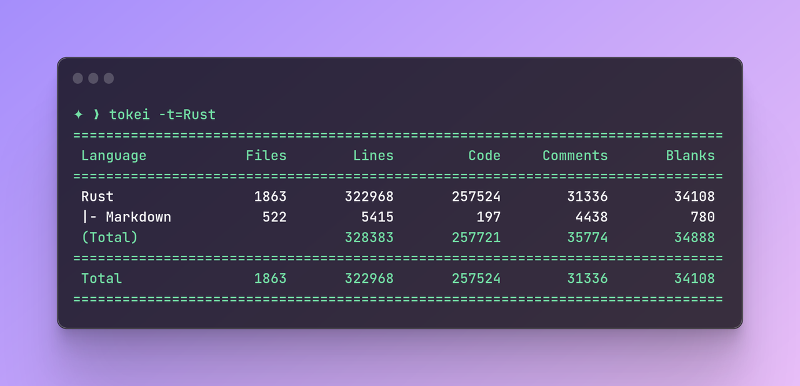
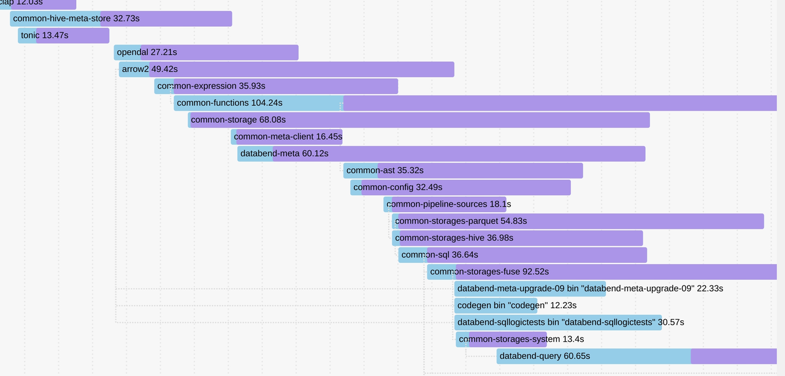
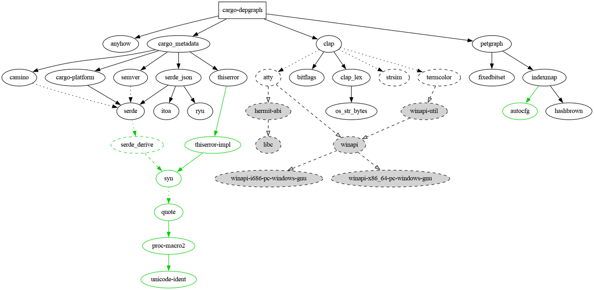
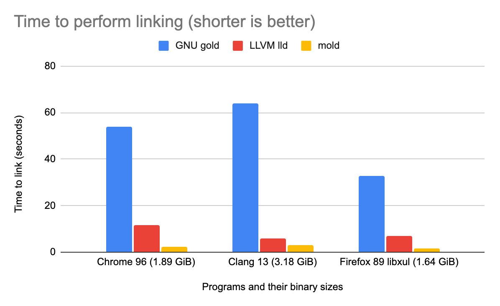
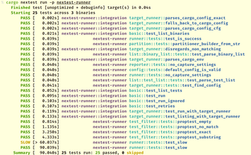
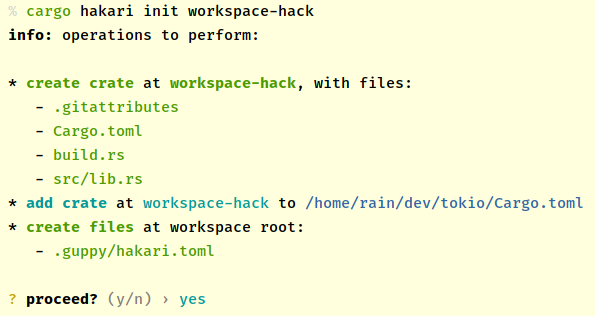

+++
title = "Tips for Optimizing Rust Compile Time in Databend"
description = "Compiled from a talk at the Rust Chinese community on April 16. A look at some of Databend's exploration in optimizing Rust compile time."
date = 2023-04-16
slug = "rust-compile-time-tips-in-databend"

[taxonomies]
tags = ["2023", "Databend", "Rust", "Archive"]

[extra]
lang = "en"
source_url = "https://www.databend.cn/blog/category-engineering/databend-tips-for-rust-compile"
source_note = "English translation of the Chinese original by PsiACE, first published on 2023-04-16. Source: "
source_label = "Databend blog original"
source_tail = ". This translation was prepared for this archive; the figures are served from this archive."
+++

## Background

By now Databend has grown into a large, complex and complete database system.
The team maintains hundreds of thousands of lines of code, ships a dozen or so build artifacts with every release, and also provides Docker-based build tooling to improve the developer / CI experience.



Earlier articles introduced PGO, which lets users tune the Databend build for their own workload.
Even earlier, there was another article introducing the Databend development environment and compilation.
For a medium-to-large Rust program like Databend, compilation is really not an easy thing:


- On one hand, with complex project dependencies and boilerplate code piling up, Rust's compile time is less than ideal; Brian Anderson's article a couple of years ago also described "Rust's terrible compile times."
- On the other hand, in order to keep the build results consistent, we have to introduce techniques that keep the compile pipeline stable. This is not a matter of "do it once and be done with it": as the workflows grow more complex, one inevitably ends up in a loop.

To improve the compilation experience, Databend has done a lot of optimization work over time. Today's article will walk through with you some of the optimizations that improve compile time in Databend.

## Observability

Observability is not a means that directly optimizes compilation, but it helps us identify where the current compilation bottleneck lies, so that we can prescribe the right remedy.

### cargo build --timings

This command helps visualize a program's compilation process.

On version 1.59 or earlier, you can use `cargo +nightly build -Ztimings`.

Opening the resulting HTML in a browser shows a Gantt chart, which displays the dependency relationships among the crates in the program, as well as the degree of compilation parallelism and the volume of code generation.
By studying the chart, we can decide whether to increase the number of codegen units for a particular module, or whether to split things further in order to optimize the whole compilation flow.



### cargo-depgraph

This tool is actually not very commonly used, but it can be brought in to analyze dependency relationships. It helps to find some potential optimization points, especially when you need to replace certain similar dependencies or optimize how the crates are organized.



## Painless Optimization, Starting with Configuration Adjustments

The first step to improving the compilation experience is actually not to operate on the code directly; very often, changing just a few configuration items brings a substantial improvement.

### Bump, Bump, Booooooooom

As mentioned earlier, members of the Rust team have long been aware that compile times are currently not ideal. So the compiler team likewise has an ongoing plan of targeted optimizations. Improvements to compilation can often be found listed in the release notes.

```toml
[toolchain]
channel = "nightly-2023-03-10"
components = ["rustfmt", "clippy", "rust-src", "miri"]
```

In addition, upstream projects may likewise improve unreasonable past designs over time, and quite often these improvements ultimately show up in their effect on compilation.


The simplest way to improve compile time is to always keep up with upstream changes and to take part in building the ecosystem in the spirit of "upstream first". The Databend team has been a loyal supporter of Rust nightly from the very beginning, and provides concise guidance for updating the toolchain and dependencies.

### Caching: Meeting sccache Around the Corner

Caching is a common compilation optimization technique, and the idea is simple: store the artifacts you have pre-built, and take them out again the next time you build.

Early on, Databend used the `rust-cache` action to speed up caching in CI, with good results. Unfortunately, we frequently had to update the key by hand to clear the cache and avoid a misjudged build. What is more, Rust's early support for incremental builds was poor, and for a while one might consider how to configure the pipeline to make some trade-offs.

Over time, everything changed.


First, Sccache came back to life, and OpenDAL successfully made its way inside it, becoming an important component underpinning the Rust build-cache ecosystem. Although using it for local builds often fails to show its true power, in CI it can still bring a big surprise.

Another important change is that the Rust community realized incremental compilation does not work well for CI.

> CI builds often are closer to from-scratch builds, as changes are typically much bigger than from a local edit-compile cycle. For from-scratch builds, incremental adds an extra dependency-tracking overhead. It also significantly increases the amount of IO and the size of ./target, which make caching less effective.

## Travel Light: Pass the Cold Air to Every Dependency

There is a very interesting project in the Rust ecosystem, [https://github.com/mTvare6/hello-world.rs](https://github.com/mTvare6/hello-world.rs), which goes as far as it can to show you how to make a Rust project as bad as possible.


In particular:

> in a few lines of code with few(1092) dependencies

Rust itself is not very good at handling this automatically; it has to download all the dependencies in one go and compile them. So avoiding the introduction of useless dependencies becomes a necessity.

At first, Databend introduced cargo-udeps to check for unused dependencies. Most of the time it worked well, but its biggest drawback was that every check amounted to compiling everything once, which is clearly not worthwhile in CI.

sundy-li found another fast and handy tool called cargo-machete.


One notable advantage is that it is fast, because everything is handled with a simple regular expression. It also supports automatic fixes, which means we no longer have to search the files one by one and edit them.

That said, machete is not a perfect tool: since it only does simple regular-expression processing, some cases cannot be identified accurately. Ignoring them is fine; overall it is well worth it.

### Sparse Index

To determine which crates exist on crates.io, Cargo has to download and read the crates.io-index, an index kept in a git repository hosted on GitHub that lists all versions of all crates.

Over time, however, the index has grown substantially, making the initial fetch and updates very slow. RFC 2789 introduced the sparse index to improve the way Cargo accesses the index, hosted at [https://index.crates.io/](https://index.crates.io/).

```toml
[registries.crates-io]
protocol = "sparse"
```

### linker

If the project is relatively large and has many dependencies, a fair amount of time may be wasted on linking. Especially when you only changed a few lines of code but compilation took a long time.

The simplest fix is to choose a faster linker than the default one.



Both lld and mold can improve link times, and Databend eventually chose mold. In fact, for a program of Databend's size the difference between the two linkers is not obvious; but a potential benefit of using mold is that it saves some of the memory consumed during compilation.

```toml
[target.x86_64-unknown-linux-gnu]
linker = "clang"
rustflags = ["-C", "link-arg=-fuse-ld=/path/to/mold"]
```

### Compilation-related Configuration

First, a common one: split-debuginfo. On MacOS, rustc runs a tool called dsymutil, which analyzes the binary and then builds the debug information directory. Configuring split-debuginfo skips dsymutil, thereby speeding up the build.

```
split-debuginfo = "unpacked"
```

Another example is codegen-units. Databend uses codegen-units = 1 when compiling to strengthen optimization and keep the binary size in check. But since some dependencies take a particularly long time in code generation (because they lean heavily on macros), some limits need to be lifted for them specifically.

```
[profile.release.package]
arrow2 = { codegen-units = 4 }
common-functions = { codegen-units = 16 }
databend-query = { codegen-units = 4 }
databend-binaries = { codegen-units = 4 }
```

## Rethinking: More Reasonable Code Organization

The above were some configuration adjustments; next we will discuss the impact of refactoring on code compile time.

### Splitting into More Reasonable Crate Sizes

For a large all-in-one crate, splitting it into crates is a fairly rewarding refactor. On one hand, it can significantly improve parallelism. On the other hand, by decoupling cross-dependencies / circular dependencies, it helps Rust process code compilation faster.


At the same time, there is a potential benefit: after splitting, the code boundaries are clearer, so maintenance takes less effort.

### The Boundary between Unit-style and Integration-style Testing

Common ways of organizing unit tests include keeping a tests mod in src, and keeping the corresponding test code in the tests directory.

Following the advice of Delete Cargo Integration Tests, Databend stripped all unit tests out of the code very early on and organized them into a form like this

```
tests/
  it/
    main.rs
    foo.rs
    bar.rs
```

This form avoids compiling every file under `tests/` into a separate binary, thereby reducing the impact on compile time.

In addition, when compiling, Rust also spends a lot of time processing tests mod and docs tests; docs tests in particular require building an additional target. After adopting the organization above, they can be turned off in the configuration.

However, this form is not very elegant: everything that needs testing has to be made public, which easily breaks the modular organization of the code. An in-depth evaluation is recommended before using it.

### More Elegant Testing Approaches

In terms of compile time, it is easy to see that the more code in unit tests that needs compiling, the slower compilation naturally becomes.

Also, for Databend, a good portion of the tests are end-to-end tests of input and output; hardcoding them in unit tests would require more additional format-related work, and maintenance would be more laborious.


Databend makes clever use of golden files testing and SQL logic testing, replacing a large number of SQL query tests and output result checks embedded in unit tests, thereby further improving compile time.

## What We Left on the Table

### cargo nextest

cargo nextest makes testing as fast as lightning, and provides finer-grained statistics and an elegant view. Quite a few projects in the Rust community have greatly improved their test pipeline times by adopting cargo nextest.



But Databend cannot migrate to this tool yet. On one hand, configuration-related tests are not supported for the moment, and running cargo test separately for them would mean recompiling. On the other hand, some tests related to timeouts set a fixed execution time, and one must wait for them to finish.

### cargo hakari

For improving the compilation of dependencies, the typical example is workspace-hack: put the important shared dependencies in one directory, so that these dependencies do not have to be compiled over and over. cargo-hakari in the Rust community can automate the management of workspace-hack.



Databend, for its part, has a large number of common components, and the main binaries are all built on the common components, which implicitly fits this optimization idea. In addition, now that the workspace supports dependency inheritance, the maintenance burden has been eased.

## Summary

This article introduced some of the exploration and effort the Databend team has put into improving compile times for Rust projects, offering some suggestions for optimizing compile time from two angles: configuration optimization and code refactoring.

## References

- [Fast Rust Builds](https://matklad.github.io/2021/09/04/fast-rust-builds.html)
- [Delete Cargo Integration Tests](https://matklad.github.io/2021/02/27/delete-cargo-integration-tests.html)
- [Better support of Docker layer caching in Cargo](https://hackmd.io/@kobzol/S17NS71bh)
- [2023-04: 为什么你该试试 Sccache？](https://xuanwo.io/reports/2023-04/)
- [The Rust Performance Book - Compile Times](https://nnethercote.github.io/perf-book/compile-times.html)
- [Cargo Registry 稀疏索引的一些介绍](https://blog.dcjanus.com/posts/cargo-registry-index-in-http/)
