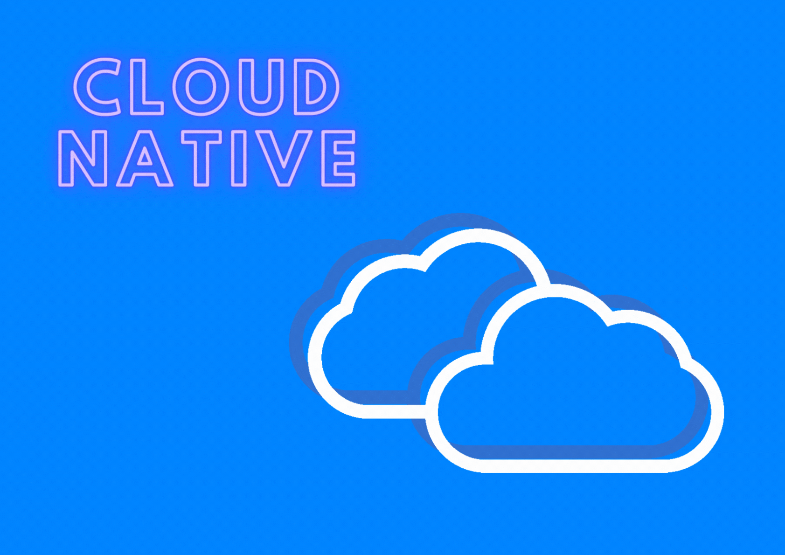
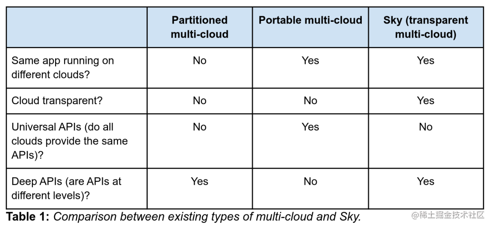
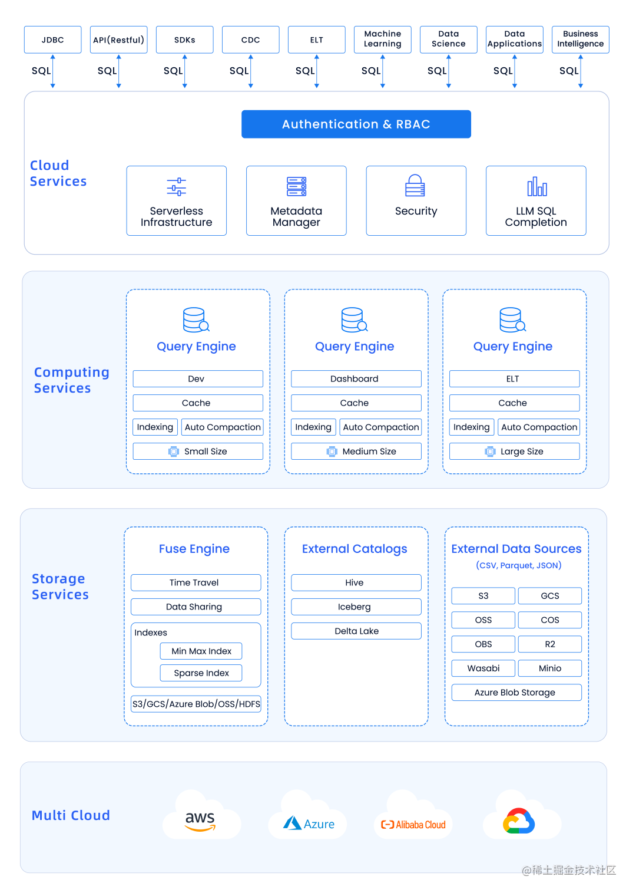
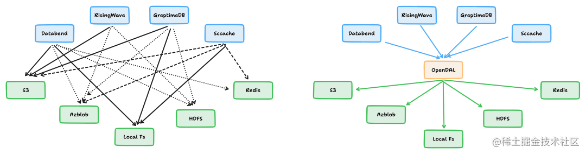
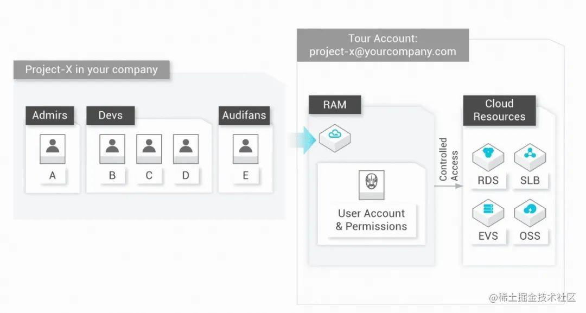
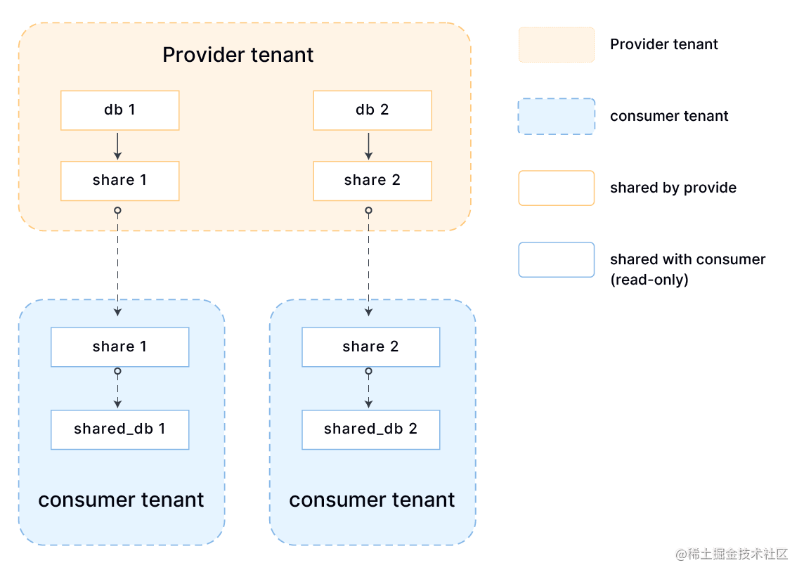

+++
title = "From Overcast to Clear: Databend's Road to Sky Computing"
description = "Sky computing background and how Databend approaches cross-cloud data storage, management, and sharing."
date = 2023-04-19
slug = "sky-computing-the-databend-way"

[taxonomies]
tags = ["2023", "Databend", "Cloud", "OpenDAL", "Archive"]

[extra]
lang = "en"
source_url = "https://juejin.cn/post/7223602277210325051"
source_note = "English translation of the Chinese original, first published on 2023-04-19. Source: "
source_label = "Juejin original"
source_tail = ". This translation was prepared for this archive."
+++

> Author: Chojan Shang (PsiACE)
>
> Master's student at Macau University of Science and Technology, R&D Engineer Intern at Databend
>
> Apache OpenDAL(Incubating) Committer
>
> [github.com/psiace/](https://github.com/psiace/)

Synopsis: This article introduces the background of sky computing, and how Databend considers cross-cloud data storage and access from the perspectives of data storage, data management, and data sharing.

## Background

The beginning of the [cloud computing](https://baike.baidu.com/item/%E4%BA%91%E8%AE%A1%E7%AE%97/9969353) era can be traced back to 2006, when [AWS](https://aws.amazon.com/) began to offer S3 and EC2 services. In 2013, the concept of cloud native had just been proposed, and there was not even a complete vision for it yet. By 2015, when [CNCF](https://www.cncf.io/) was founded, this concept became more and more popular over the next five years and became a topic that technologists could not avoid.

> According to CNCF's definition of cloud native: cloud-native technologies empower organizations to build and run scalable applications in modern, dynamic environments such as public, private, and hybrid clouds. Typical examples include: containers, service meshes, microservices, immutable infrastructure, and declarative APIs .



However, whether public cloud or private cloud, whether cloud computing or cloud service, there already exist far too many different types of "clouds" in the sky. Each "cloud" has its own unique API and ecosystem, they lack interoperability with each other, and there are very few places where they can be compatible. Clouds have become de facto islands. These islands are not only the separation between public clouds and private clouds, but also include the separation between different public clouds, between different private clouds, and between public clouds and private clouds. This island phenomenon not only brings users a lot of trouble, but also limits the development of cloud computing.

In 2021, RISELab published a paper titled [The Sky Above The Clouds](https://arxiv.org/abs/2205.07147), discussing the future of sky computing. Sky computing further extends the idea of cloud native to encompass public clouds, private clouds, and edge devices. Its goal is to realize a unified API and ecosystem, so that different clouds can collaborate and interact seamlessly. In this way, users can freely migrate applications and data between different clouds without worrying about compatibility and migration costs. At the same time, sky computing can also provide more efficient, more secure, and more reliable computing services, thereby satisfying users' growing demands for cloud computing. Overall, sky computing is committed to allowing applications to run across multiple cloud providers and to achieving interoperability between multiple clouds.


*(The figure above is cited from the paper, showing the difference between different types of multi-cloud and sky computing)*

## The Databend Way

### The key to crossing clouds

Databend can satisfy users' needs to freely access data and query it across different clouds without worrying about compatibility and migration costs. At the same time, Databend can also provide more efficient, more secure, and more reliable computing services, thereby satisfying users' growing demands for cloud computing. From this perspective, Databend has already initially formed a sky computing solution. So, for Databend, where exactly does the key to crossing clouds lie?


*(The figure above shows the architecture of Databend Cloud)*

Databend adopts a storage-compute separation architecture and makes design decisions entirely oriented toward cloud object storage. Thanks to the separation of storage and compute, and the separation of storage and state, Databend can achieve fine-grained control over resources, easily deploy and scale Query and Meta nodes , and support a variety of different computing scenarios and storage scenarios without having to consider cross-cloud data management and movement.

Query nodes and Meta nodes are themselves lightweight services, and have no strict dependencies on the deployment environment. But the storage and access management of data is a different matter: we need to consider the API compatibility between different cloud services, and how to interact with the security mechanisms of the cloud services themselves so as to provide a more secure access control mechanism. For Databend, the key to crossing clouds — or to realizing sky computing — lies in the management and access of data.


*（OpenDAL can turn the data access problem from M\N into M+N）*

To solve this problem, Databend abstracts a unified data access layer (OpenDAL, now an incubating project under the Apache Software Foundation), thereby shielding the API compatibility issues between different cloud services. In the following sections, we will observe Databend's painless data access experience from different perspectives, and experience the charm of truly fully cloud-native sky computing.

### Data storage

The details of Databend's storage backend are hidden behind simple configuration; by modifying the configuration file you can easily switch between a dozen or so storage services. For example, if you want to use AWS S3, you only need to specify the type as `s3` , and Databend will automatically try to authenticate using IAM. If you want to use other S3-compatible object storage services, you can also adjust settings such as `endpoint_url` .

```toml
[storage]
type = "s3"

[storage.s3]
bucket = "databend"
```

Of course, supporting only S3-compatible object storage services is not enough. Through OpenDAL, Databend implements native storage backend support for services such as Google Cloud Storage, Azure Blob, Aliyun OSS, Huawei OBS, and HDFS.
This means Databend can make full use of the APIs provided by various vendors to bring users a better experience. For example, native support for Aliyun OSS allows Databend to authenticate and authorize users through Aliyun RAM without setting static keys, thereby greatly improving security and reducing operational burden.


*(The figure above is selected from the Aliyun official website, showing access control scenarios and capabilities)*

In addition, native support can also avoid unexpected behavior and provide tighter integration with service providers. Although the major vendors all provide S3-compatible APIs, there are subtle differences between them, which may lead to degraded service performance or abnormal data read/write functionality when unexpected behavior occurs. Google Cloud Storage provides an S3-compatible XML API, but does not support the ability to delete objects in bulk. This caused users to encounter unexpected errors when calling that interface. Native support for Google Cloud Storage means Databend does not have to worry about the impact of GCS's S3-compatible implementation on users' business.

In short, Databend provides users with efficient and reliable data analysis services by implementing native support for each service.

### Data management

We have discussed cross-cloud support for storage backends; now let us focus on data management. More specifically, the inflow and outflow of data in Databend's workflow.

#### COPY INTO, data loading

To talk about data management, we have to discuss where the data comes from. In the past, you might have needed to consider whether to migrate storage services, but now you can load data from dozens of storage services supported or compatible with Databend, and everything feels so natural.

The `COPY INTO` statement is a window into Databend's cross-cloud capabilities. The example below shows how to load data from Azure Blob into Databend.

```sql
COPY INTO mytable
    FROM 'azblob://mybucket/data.csv'
    CONNECTION = (
        ENDPOINT_URL = 'https://<account_name>.blob.core.windows.net'
        ACCOUNT_NAME = '<account_name>'
        ACCOUNT_KEY = '<account_key>'
    )
    FILE_FORMAT = (type = CSV);
```

Of course, it is not only Azure Blob : the other cloud object storage services supported by Databend, IPFS, and files accessible via HTTPS can all serve as External locations and be loaded through the `COPY INTO` statement.

> Databend's `COPY INTO` statement also supports basic transformation services, which can lighten the burden of ETL work.

#### Stage , data staging area

Just now we mentioned External locations ; in fact, the data files to be loaded into Databend can also be staged in a Stage . Databend likewise supports Internal stage and Named external stage .

Data files can be uploaded to an Internal Stage via the `PUT_INTO_STAGE API` , and Databend hands them to the currently configured storage backend for unified management. A Named external stage , on the other hand, can be used to mount buckets from the various storage services supported by Databend .

The example below shows how to create a Stage named whdfs in Databend, importing data files from the data-files directory in HDFS into Databend through the WebHDFS protocol.

```sql
bendsql> CREATE STAGE IF NOT EXISTS whdfs URL='webhdfs://127.0.0.1:9870/data-files/' CONNECTION=(HTTPS='false');
Query OK, 0 rows affected (0.01 sec)

bendsql> COPY INTO books FROM @whdfs FILES=('books.csv') file_format=(type=CSV field_delimiter=','  record_delimiter='\n' skip_header=0);
Query OK, 2 rows affected (1.83 sec)
```

> If you do not want to import the data directly, you can also try `SELECT FROM STAGE` to quickly analyze the data files located in the staging area.

#### Catalog, data mounting

Loading data placed in object storage has been solved, but there is another question worth thinking about: what if the data is originally managed by another data analysis system?

Databend provides support for multiple source data catalogs (Multiple Catalog), allowing you to mount external data catalogs such as Hive and Iceberg .

The example below shows how to mount a Hive data catalog using the configuration file.

```toml
[catalogs.hive]
type = "hive"
# hive metastore address, such as 127.0.0.1:9083
address = "<hive-metastore-address>"
```

Besides mounting, querying is also a piece of cake `select * from hive.$db.$table limit 10;` .

Of course, all of this can also be easily done through the `CREATE CATALOG` statement; the example below shows how to mount an Iceberg data catalog.

```sql
CREATE CATALOG iceberg_ctl
  TYPE=ICEBERG
  CONNECTION=( 
    URL="s3://my_bucket/path/to/db" 
    AWS_KEY_ID="<access-key>"
    AWS_SECRET_KEY="<secret_key>"
    SESSION_TOKEN="<session_token>"
  );
```

> Capabilities related to Multiple Catalog are still being actively developed and iterated; if you are interested, stay tuned.

#### Revisiting COPY INTO, data export

Data export is another important topic in data management. Simply put, it means dumping query results for further analysis and processing.

This capability is likewise supported by the `COPY INTO` syntax, and of course likewise supports dozens of storage services and multiple file output formats. The example below shows how to export query results to a specified Stage in the form of a CSV file.

```sql
-- Unload the data from a query into a CSV file on the stage
COPY INTO @s2 FROM (SELECT name, age, id FROM test_table LIMIT 100) FILE_FORMAT = (TYPE = CSV);
```

This syntax also supports exporting to External locations , truly enabling the free flow of data.

> Databend also supports `PRESIGN` , which is used to generate a pre-signed URL for a file in a Stage, and users can freely access that file through a web browser or an API request.

### Data sharing

The cross-cloud nature of the Databend data management described above mainly refers to the interaction between Databend and external services. In addition, Databend instances can also share data through a variety of cloud storage services.

To better meet database query needs in multi-cloud environments, Databend designed and implemented a set of RESTful APIs to support data sharing.


*（The figure above shows the workflow of data sharing）*

By adding the relevant `share_endpoint_address` configuration to the configuration file, users can use a pre-deployed `open-sharing` service to share databases or tables managed by Databend through familiar cloud storage services.

```sql
CREATE SHARE myshare;
GRANT USAGE ON DATABASE db1 TO SHARE myshare;
GRANT SELECT ON TABLE db1.table1 TO SHARE myshare;
ALTER SHARE myshare ADD TENANTS = vendor;
```

At this point, the table `db1.table1` will be visible to the recipient tenant `vendor` and can be queried as needed.

```sql
CREATE DATABASE db2 FROM SHARE myshare;
SELECT * FROM db2.table1;
```

### The future of crossing clouds

The several perspectives above are only a small cross-section of Databend on the road to sky computing.

Data compliance, privacy protection, and other topics are also important issues that we care about.

Databend's vision is to become the cornerstone of future cross-cloud analytics, making data analysis simpler, faster, more convenient, and more intelligent.

## Summary

This article introduced the concept and background of sky computing, as well as Databend's cross-cloud data storage and access.

Sky computing is a method that unifies public clouds, private clouds, and edge devices, with the goal of providing a seamless API and ecosystem so that users can freely migrate applications and data between different clouds.

Databend is an open-source modern data warehouse fully oriented toward cloud architecture. It adopts a storage-compute separation architecture and abstracts a unified data access layer (OpenDAL), thereby shielding the API compatibility issues between different cloud services. Databend can satisfy users' needs to freely access data and query it across different clouds without worrying about compatibility and migration costs. At the same time, Databend can also provide more efficient, more secure, and more reliable computing services, thereby satisfying users' growing demands for cloud computing.

You are welcome to deploy Databend or visit Databend Cloud , and explore the endless charm of sky computing right away.

## About Databend

Databend is an open-source, elastic, low-cost modern data warehouse built on object storage that can also do real-time analytics. We look forward to your attention as we explore cloud-native data warehouse solutions together and build a new generation of open-source Data Cloud.

👨‍💻‍ Databend Cloud: [databend.cn](https://databend.cn)

📖 Databend Docs: [databend.rs/](https://databend.rs/)

💻 Wechat: Databend

✨ GitHub: [github.com/datafuselab…](https://github.com/datafuselabs/databend)
