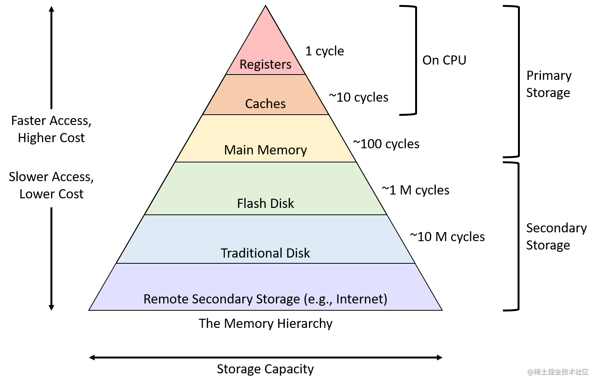
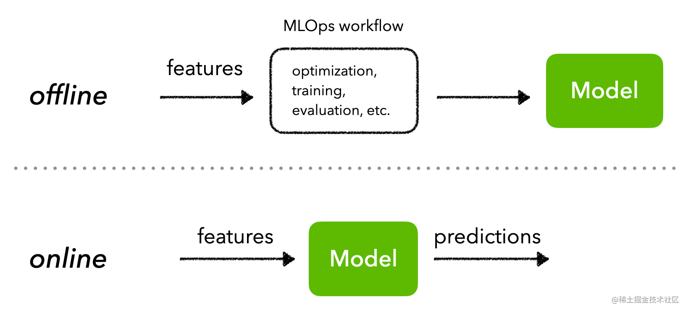
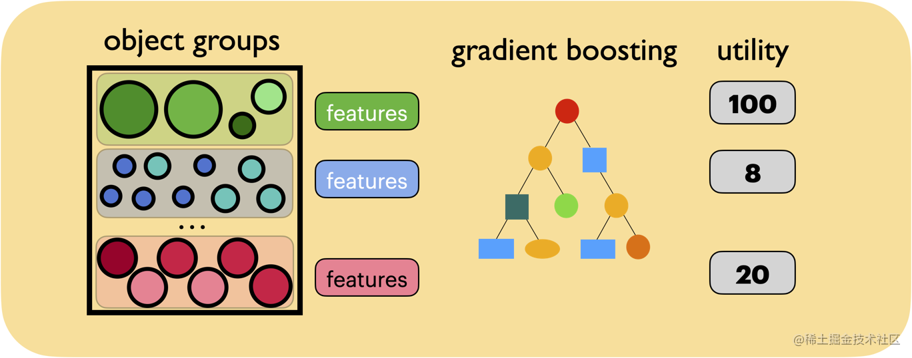
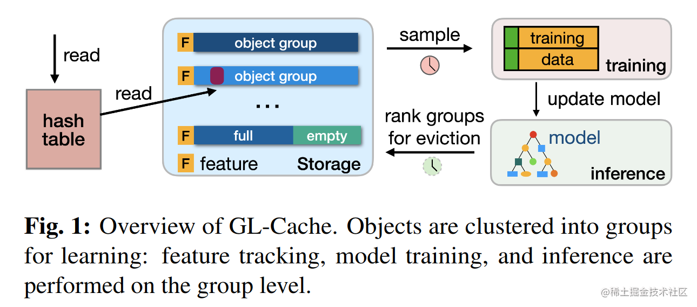
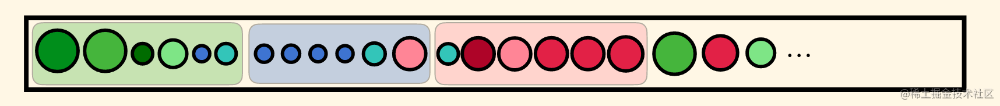
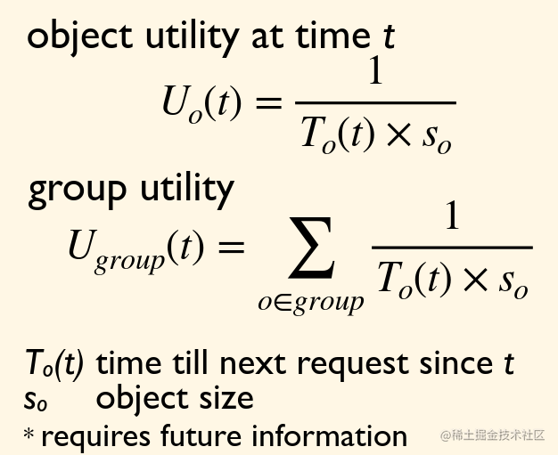
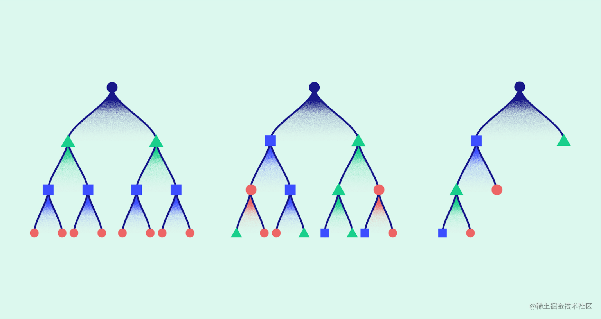
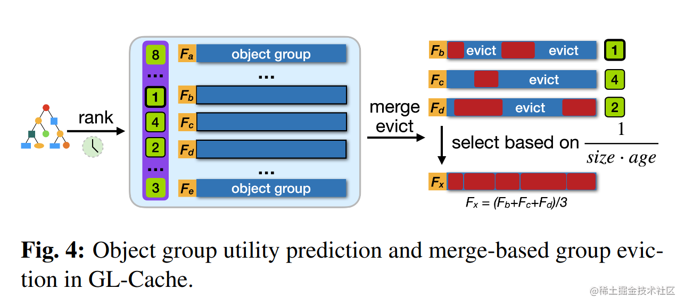
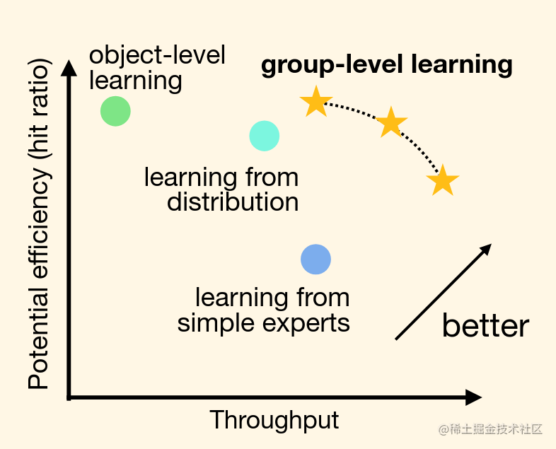

+++
title = "Paper Walkthrough: GL-Cache, a Cache Replacement Algorithm Based on Group-level Learning"
description = "A walkthrough of the FAST '23 GL-Cache paper: group-level learning, grouping strategy, utility, features, and merge eviction."
date = 2023-05-29
slug = "gl-cache-group-level-learning"

[taxonomies]
tags = ["2023", "Paper", "Cache", "Databend", "Archive"]

[extra]
lang = "en"
source_url = "https://juejin.cn/post/7238274120881717304"
source_note = "English translation of the Chinese original, first published on 2023-05-29. Source: "
source_label = "Juejin original"
source_tail = ". This translation was prepared for this archive."
+++

> Author: Chojan Shang (PsiACE)
>
> Master's student at Macau University of Science and Technology, R&D Engineer Intern at Databend
>
> Apache OpenDAL(Incubating) Committer
>
> [github.com/PsiACE](https://github.com/PsiACE)

> **Original paper:**
>
> [GL-Cache: Group-level learning for efficient and high-performance caching | FAST '23](https://www.usenix.org/system/files/fast23-yang.pdf)
>
> **Source code** **address:**
>
> [github.com/Thesys-lab/…](https://github.com/Thesys-lab/fast23-GLCache)
>
> **Paper contributions:**
>
> It proposes Group-level Learning , which uses the characteristics of multi-object groups to adapt to the workload and cache size, accumulates stronger learning signals through grouping, and amortizes the learning cost to the object level. GL-Cache not only provides an efficient learned cache, but also guarantees high throughput of the cache system.

## **Abstract**

Web applications rely heavily on software caches to achieve low-latency, high-throughput service. To adapt to constantly changing workloads, several learned caches (learned cache replacement policies, especially eviction policies) have been designed in recent years, and they can be roughly divided into three kinds: object-level learning, learning from a distribution, and learning from simple experts (a policy set). This paper argues that the learning granularity of existing approaches is either too fine (object level), which makes computation and storage costs too high, or too coarse (workload or expert-policy level), which cannot capture the differences between objects, leaving a considerable efficiency gap. (Here efficiency is mainly evaluated by the hits/miss ratio.)

In this paper, the authors design a new learning method for caching — group-level learning. This method clusters similar objects into groups, and performs learning and eviction on a per-group basis. Group-level learning can accumulate more signals, is able to use more features with adaptive weights, and amortizes the cost across objects, thereby achieving high efficiency and high throughput.

The authors demonstrate group-level learning with GL-Cache in a production environment, and evaluate it on 118 production block I/O and CDN cache traces. The results show that GL-Cache has a higher hit ratio and higher throughput than state-of-the-art designs. Compared with LRB (object level), GL-Cache improves throughput by 228 times and hit ratio by 7% on average; for CDN cache traces at P90, GL-Cache provides a 25% hit ratio improvement over LRB; compared with the best performer of all other types, GL-Cache improves throughput by 64% and hit ratio by 3% on average, and improves hit ratio by 13% at P90.

## **Background**

Before formally discussing GL-Cache, let us first look at some background on caching and learned caching.

### **Storage hierarchy**

The figure above reflects the storage hierarchy in computer architecture; an obvious trend is that the greater the speed, the smaller the capacity. The cache in the figure sits inside the CPU, and is used to reconcile the CPU's running speed with the memory's read speed.

Generally speaking, a cache sits between two kinds of storage whose speeds differ greatly, and is used to reconcile the difference in data transfer speed between them. No matter which level of cache it is, all of them face the same problem: once the free space of a capacity-limited cache is fully used up and new content needs to be added to the cache, how do we select and discard part of the existing content, so as to free up space for the new content?

This paper discusses the cache located between memory and disk, not the cache on the chip.

### **Cache evaluation criteria**

This article mainly adopts the following two evaluation criteria.

- "Efficiency"
  - Evaluated by the hits/miss ratio.
- "Performance"
  - Evaluated by throughput.

### **Evolution of cache replacement algorithms**

- "Single-type" policies
  , typical examples include LRU and CLOCK . This kind of static policy cannot adapt to changes in the workload, and lacks comprehensive performance.
- "Adaptive" policies
  , typical examples include ARC and 2Q . They usually need to maintain extra metadata to adapt to the workload, and the implementation complexity increases accordingly. Adaptation is not always foolproof.
- "Learned" policies
  , typical examples include LeCaR and ACME . They can be regarded as adaptive policies driven by machine learning/deep learning, using learning to improve decisions and thereby gaining in efficiency, but they often cannot guarantee high throughput.

The work in this paper belongs to the learned policies, but thanks to some decisions in the design and implementation, it achieves fairly good gains in both efficiency and performance.

### **Further discussion of learned caches**

The preceding section introduced **learned caches**, a class of methods that combine machine learning to improve cache adaptivity. According to this paper's classification, they can be roughly divided into the following kinds:

- "Object-level" learning
  , that is, learning the features of each individual object. By predicting the reuse distance, a cache replacement policy similar to Belady's algorithm can be realized. However, the storage and computation costs of object-level learning are both relatively large. Taking LRB as an example, it can learn more than 40 features; if sampling and prediction are performed on every eviction, throughput will be greatly harmed.
- Learning from a distribution
  , making decisions based on the request probability distribution. For example, LHD uses the request probability distribution to compute hit density as the eviction metric, which is relatively simple and efficient with low computational cost. However, LHD's hit density computation is based on only two features: age and size , which limits the ceiling of efficiency, while tracking more features would make the computation grow exponentially. In addition, because LHD needs to sample and compare objects on every eviction/random access, its throughput is limited.
- Expert policy sets
  , unlike the previous two, which improve the eviction algorithm itself, expert policy sets aim to learn and select the cache replacement policy that best suits the workload. Typical examples are LeCaR and its follow-up work CACHEUS . The drawbacks of expert policy sets are mainly the following two aspects: they need to maintain the state or metadata of different caching algorithms, and the implementation and computational complexity both increase if multiple different algorithms are maintained, while their hit ratio depends strongly on the policy they select; in addition, expert policy sets suffer from "delayed reward" and need to track accesses to objects, while there may be a fairly long interval between two accesses, during which the workload may change.

### **Some trade-offs about whether to introduce** **machine learning**

Machine learning is often used to improve decision-making processes. The main consideration in combining cache management with machine learning is to improve performance, including how to increase throughput and how to improve the hit ratio.

**Why use** **machine learning**

- In recent years machine learning has been widely applied and has influenced the design and implementation of caches and indexes. At FAST '23 there were other papers on learned indexes and learned caches accepted in the same period. Algorithms based on machine learning usually have advantages in real-world scenarios.
- Machine learning can be used to learn the "best" cache replacement policy. LeCaR can be categorized into this class.
- Machine learning can be used to improve existing cache replacement policies. This paper belongs to this class.

**Why not use** **machine learning**

- The correctness of the implementation needs further evaluation, and the complexity also increases.
- Many schemes must introduce extra steps, such as model training and deployment. LeCaR introduces an online learning mechanism, avoiding the training and deployment problems.
- It is hard to take both efficiency and performance into account at the same time. This paper adopts the Group-level Learning strategy and achieves advantages in both efficiency and performance.

## **GL-Cache: Group-level Learned Cache**

The previous sections spent a lot of space introducing caches and the application of machine learning in caching. Next, let us turn our attention to the protagonist of this article, GL-Cache .

GL-Cache adopts the idea of group-level learning, grouping objects and aggregating features by group.

- Compared with other learned caches, GL-Cache can use multiple features to assist decision-making, thereby improving cache efficiency. In addition, GL-Cache's computation and storage costs are amortized across the objects within a group.
- Most cache workloads follow a specific distribution, and many objects may be accessed only a handful of times, so it is hard to learn valuable information from a few individual objects. By aggregating them into groups, the number of objects and access requests within a group accumulate, forming more information that helps learning and prediction.

### **Design trade-offs**

GL-Cache divides objects into a number of groups, periodically tracks the features of each object group, samples and forms feature snapshots, computes the utility of each feature snapshot and uses it for model training, and then uses the trained model to predict and make eviction decisions.

### **Grouping strategy**

GL-Cache chooses a grouping strategy based on insertion time, which is simple and effective. It is mainly for the following reasons:

- Between objects with similar insertion times, the similarity of access frequency and reuse distance is closer than between random objects.
- It is simple and general, and can be easily integrated with other cache designs.
- It can be implemented on segment-based or log-structured storage, thereby exploiting the advantages of log-structured storage: low fragmentation, high throughput, Flash-friendliness, and so on.

Of course, different grouping strategies can also be designed according to actual needs to further adapt to the workload.

### **Utility computation**

**Utility** is used to measure the subsequent impact of evicting or retaining an object group. By design, object groups with lower utility should be evicted preferentially.

Comparison between individual objects is very easy, but between groups there is still a lack of an effective measure. The paper designs a new utility function to quantify the utility of an object group.

The main decisions in designing utility are as follows:

- If a group mainly contains small objects, its utility is greater.
- The smaller the interval to the next request, the greater the utility.
- If the group size is 1 , that is, when it degenerates to object-level learning, it should behave like Belady's MIN algorithm.
- It is easy to learn, can accurately reflect utility, and can be computed online in real time.

The first formula in the figure above shows the computation of the utility function for a single object, where T(o)(t) represents the time of the next request and S(o) represents the size of the object. The utility of a group can be computed as the sum of the utilities of its objects.

### **Features and model**

GL-Cache selects 7 features for learning, and classifies them.

**Dynamic features**, that is, features that need to be updated on access requests:

- Number of requests
- Number of active objects

**Static features**, which do not need real-time updates and only need to be computed once:

- Write rate at insertion time
- Miss ratio at insertion time
- Request rate at insertion time
- Average object size
- Age of the group

Among them, the first three static features are also called **context features** , and can reflect changes in the workload. For example, during data backup, one may observe that the write rate, miss ratio, and request rate are all increasing.

The model is fairly simple: it uses gradient boosted trees to design a regression algorithm as the objective function. If you are interested, you can read the relevant xgboost papers and the paper's relevant source code; we will not go into detail here.

### **Eviction plan**

GL-Cache uses the trained model to rank object groups, predict their utility, and select the group with the lowest utility for eviction.

However, GL-Cache's eviction does not directly delete the corresponding group; instead, it adopts the idea of Merge Evict :

- First, select the group to be evicted together with several adjacent groups whose insertion times are close to it;
- Then, delete most of the objects from these groups according to the algorithm in the figure above;
- Finally, merge the remaining elements to form a new object group.

Because several adjacent groups with close insertion times are chosen as the merge targets, the new group formed after eviction can still guarantee the similarity of the features of the objects within the group.

### **Performance evaluation**

Let us skip the experiment design and result details of the evaluation, and just briefly look at where the group-level learning based algorithm stands in the quadrant of potential efficiency (hit ratio) and performance (throughput).

- Object-level learning has the highest hit ratio, but because of its heavy computation it performs poorly in throughput.
- Expert policy sets, because their models are relatively simple, can achieve better throughput, but they are limited by the simple expert algorithms themselves (LRU, LFU, and so on) and have a lower hit ratio.
- Learning from a distribution is relatively balanced, sitting between the former two.
- The Group-level Learning proposed in this paper performs excellently in both potential efficiency and performance.

## **Summary**

This paper proposes a new method called "group-level learning (Group-level Learning)", which uses machine learning to improve cache efficiency. Group-level learning uses features of multiple object groups to predict and evict the object group with the lowest utility; it adapts to the workload and cache size while accumulating stronger signals for learning, and amortizes the learning cost across objects. Therefore, it can make better eviction decisions at an extremely small cost. The authors build GL-Cache in a production-grade cache to demonstrate group-level learning, and evaluate it on 118 production block I/O and CDN traces. Compared with all other known caches, GL-Cache achieves significantly higher throughput while maintaining a high hit ratio. Therefore, GL-Cache paves the way for adopting learned caches in production systems.
