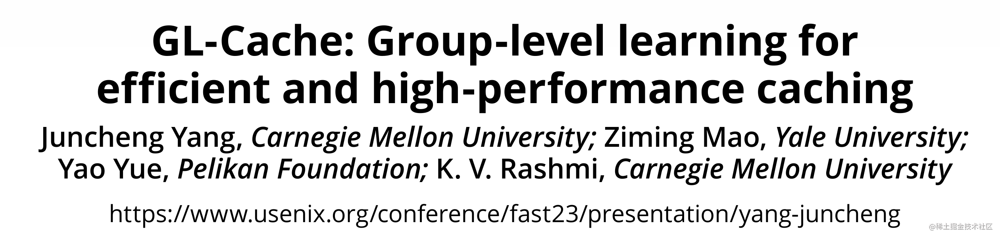
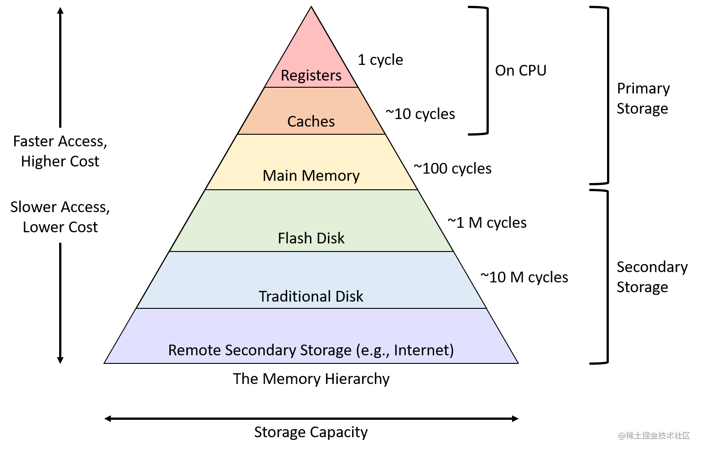
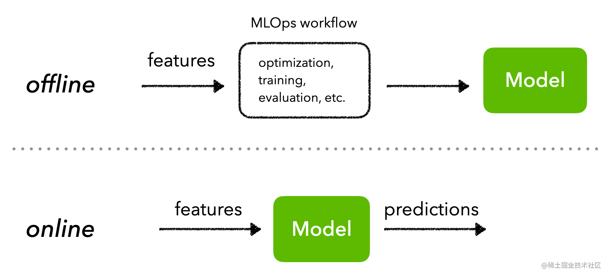
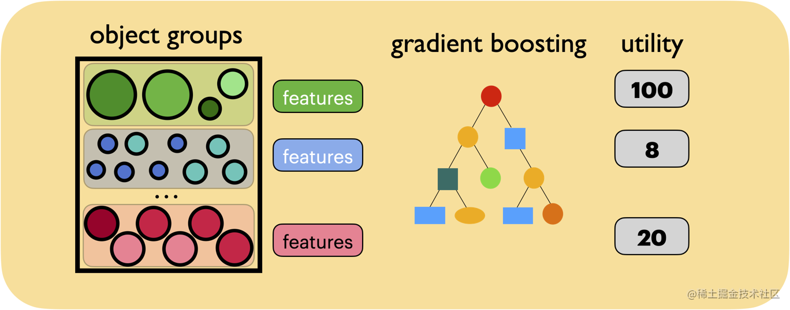
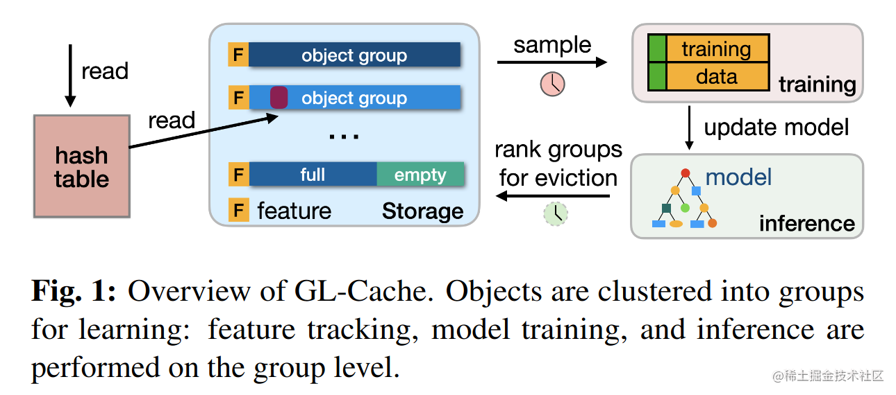
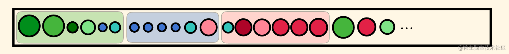
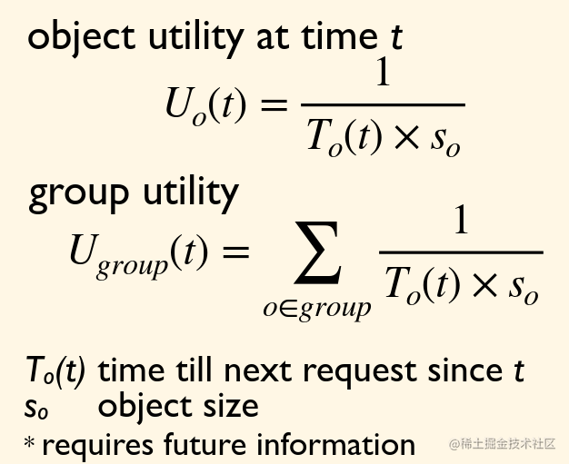
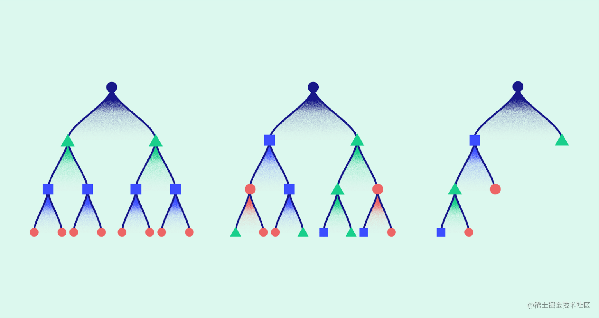
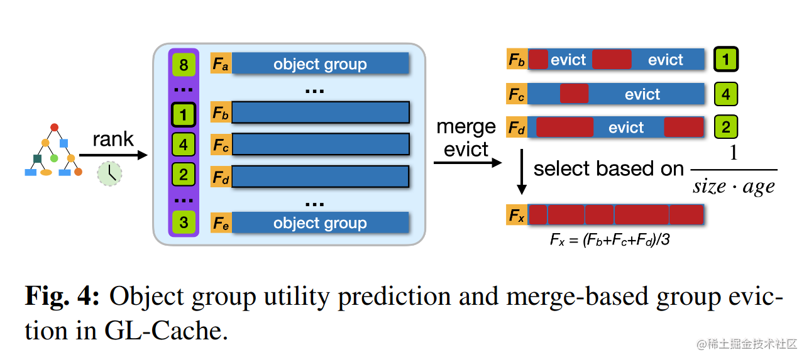
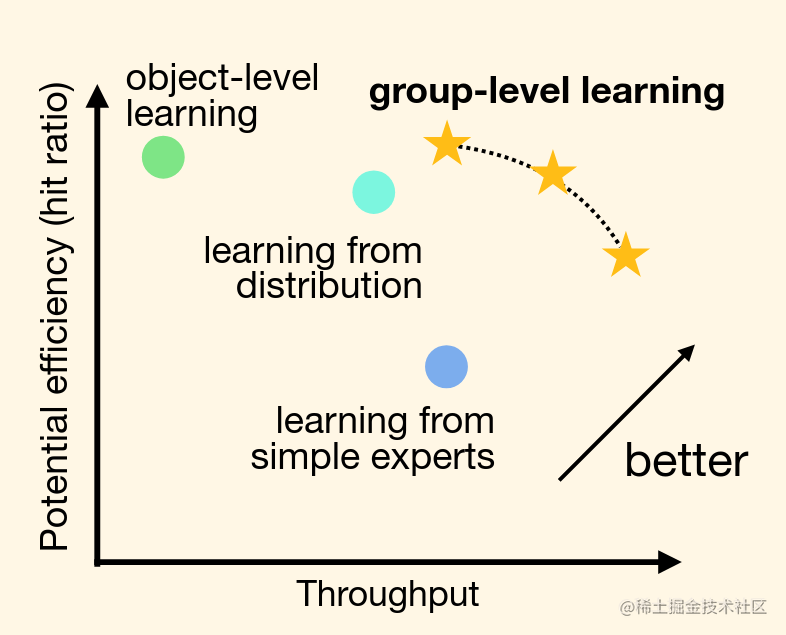

+++
title = "【论文解读｜GL-Cache 】基于组级学习的缓存替换算法"
description = "FAST '23 GL-Cache 论文解读：组级学习、分组策略、效用计算、特征与合并逐出。"
date = 2023-05-29
slug = "gl-cache-group-level-learning"

[taxonomies]
tags = ["2023", "论文", "缓存", "Databend", "归档"]

[extra]
lang = "zh"
source_url = "https://juejin.cn/post/7238274120881717304"
source_note = "本文原发于 2023-05-29："
source_label = "掘金原文"
source_tail = "。此处为存档版本，正文按原文照录。"
+++

> 作者：尚卓燃（PsiACE）
>
> 澳门科技大学在读硕士，Databend 研发工程师实习生
>
> Apache OpenDAL(Incubating) Committer
>
> [github.com/PsiACE](https://github.com/PsiACE)

> **论文原文：**
>
> [GL-Cache: Group-level learning for efficient and high-performance caching | FAST '23](https://www.usenix.org/system/files/fast23-yang.pdf)
>
> **源码** **地址：**
>
> [github.com/Thesys-lab/…](https://github.com/Thesys-lab/fast23-GLCache)
>
> **论文贡献：**
>
> 提出 Group-level Learning ，利用多对象组的特征来适应工作负荷和缓存大小，通过分组来积累更强的学习信号，学习成本均摊到对象级别。GL-Cache 不仅提供高效益的学习型缓存，还能够保证缓存系统的高吞吐量。

## **Abstract**

网络应用程序在很大程度上依赖于软件缓存来实现低延迟、高吞吐的服务。为了适应不断变化的工作负载，近年来设计出一些学习型缓存（学习型缓存替换策略，特别是逐出策略），大致可以分为三种：对象级别学习、从分布中学习和从简单专家（策略集）中学习。本论文认为现有方法的学习粒度要么太细（对象级别），导致计算和存储成本过大，要么太粗（工作负载或专家策略级），无法捕捉对象之间的差异，留下了相当大的效益差距。（这里的效益主要是由 hits/miss ratio 进行评估）

在本论文中，作者针对缓存设计了一种新的学习方法——组级别学习。该方法将相似的对象聚类成组，并按照组进行学习和逐出操作。组级学习可以积累更多的信号，能够利用更多具有自适应权重的特征，并将成本分摊到对象上，从而实现高效益和高吞吐量。

作者使用 GL-Cache 在生产环境下演示了组级别学习，并对 118 个生产块 I/O 和 CDN 缓存跟踪进行评估。结果显示 GL-Cache 比最先进设计具有更高命中率和更高吞吐量。与 LRB （对象级别）相比，GL-Cache 平均提升 228 倍吞吐量和 7% 命中率；对于 CDN 缓存跟踪 P90 的情况下，GL-Cache 比 LRB 提供了25% 的命中率提升；与所有其他类型最好表现者相比较，在平均值方面 GL-Cache 提升64% 吞吐量、3% 命中率，在 P90 方面提升13% 命中率。

## **Background**

在正式讨论 GL-Cache 之前，让我们先来看一下缓存和学习型缓存相关的一些内容。

### **存储层次结构**

上图反映了计算机体系中的存储层次结构，可以看到明显的趋势是速度越大，容量越小。图中的缓存位于 CPU 内部，用于协调 CPU 运行速度和内存读取速度。

一般而言，缓存是位于速度相差较大的两种存储之间，用于协调两者数据传输速度差异的结构。无论是哪一层次的缓存都面临一个同样的问题：当容量有限的缓存的空闲空间全部用完后，又有新的内容需要添加进缓存时，如何挑选并舍弃原有的部分内容，从而腾出空间放入这些新的内容。

本论文讨论的是位于内存/磁盘之间的缓存而不是芯片上的缓存。

### **缓存评价标准**

本文主要选用以下两个方面的评价标准。

- **“效益“** - 根据 hits/miss ratio 进行评估。
- **”性能“** - 根据吞吐量进行评估。

### **缓存替换算法的演进**

- **“单一型”策略**，典型的例子包括：LRU 和 CLOCK 。这一类静态策略无法适应工作负载的变化，且缺乏全面的性能表现。
- **“适应型”策略**，典型的例子包括：ARC 和 2Q 。通常需要维护额外的元数据来适应工作负载，同时实现的复杂度也会随之提高。适应并不总是万无一失。
- **“学习型”策略**，典型的例子包括：LeCaR 和 ACME 。可以看作是由机器学习/深度学习驱动的适应型策略，利用学习改进决策，从而在效益上获得提高，但往往不能保证高吞吐量。

本论文工作属于学习型策略，但得益于设计实现上的一些决策，在效益和性能上都取得了比较好的收益。

### **进一步讨论学习型缓存**

前面介绍了**学习型缓存**，这是一类结合机器学习来改善缓存适应性的方法，根据本论文的分类，大致可以分成以下几种：

- **”对象级“学习**，即对每个对象的特征进行学习。通过预测重用距离，可以实现类似 Belady 算法的缓存置换策略。但是，对象级学习的存储和计算成本都比较大，以 LRB 为例，可以对超过 40 种特征进行学习，如果在每次逐出元素时进行采样和预测，会极大妨害吞吐量。
- **从分布中学习**，基于请求概率分布做出决策。例如，LHD 使用请求概率分布计算命中密度作为逐出的指标，相对而言较为简单高效，计算成本低。但是，LHD 命中密度的计算仅基于两个特征：age 和 size ，限制了效益的上限，而跟踪更多特征的话，计算量会呈现指数级增长。此外，由于 LHD 需要在每次逐出/随机访问时对对象进行采样和比较，限制了其吞吐量。
- **专家策略集**，与前两种对逐出算法的改进不同，专家策略集旨在学习并选出最适合工作负载的缓存替换策略。典型的例子就是 LeCaR 和其后续工作 CACHEUS 。专家策略集的缺陷主要是以下两个方面：需要维护不同缓存算法的状态或者元数据，如果要维护多个不同算法，实现复杂度和计算复杂度都会提高，且其命中率强依赖于其所选策略；另外，专家策略集存在“延迟奖励”，需要跟踪对对象的访问情况，而两次访问之间可能会存在相当长的间隔，工作负载可能会在此期间发生变化。

### **关于是否引入** **机器学习** **的一些权衡**

机器学习经常用于改进决策过程。将缓存管理和机器学习相结合的主要考虑因素是提高性能，包括如何增加吞吐量以及如何提高命中率。

**为什么要使用** **机器学习**

- 机器学习近年来被广泛应用，并影响了缓存、索引的设计和实现。FAST ‘23 同期还有其他关于学习型索引和学习型缓存的论文被接收。基于机器学习的算法在真实世界场景中通常具有优势。
- 可以利用机器学习来学习“最佳”缓存替换策略。LeCaR 可以归到这一类中。
- 可以利用机器学习来改进现有的缓存替换策略。本论文属于此类。

**为什么不使用** **机器学习**

- 实现的正确性需要进一步评估，复杂度也会增加。
- 许多方案必须引入额外步骤，如模型的培训和部署等。LeCaR 引入在线学习的机制，避免了训练和部署问题。
- 难以同时兼顾效益和性能。本文采用 Group-level Learning 的策略，同时在效益和性能上取得优势。

## **GL-Cache: Group-level Learned Cache**

前面花了大量的篇幅介绍缓存和机器学习在缓存中的应用，接下来让我们将目光转向本文的主角 GL-Cache 。

GL-Cache 采用组级学习的思想，将对象分组，并按组聚集特征。

- 与其他学习型缓存相比，GL-Cache 可以利用多个特征来辅助决策，从而提高缓存效益。此外，GL-Cache 的计算成本和存储成本由组内的对象均摊。
- 大多数缓存工作负载遵循特定的分布，很多对象可能只访问零星几次，很难从单独几个对象中学到有价值的信息。而通过汇聚成组的形式，组内对象数目和访问请求得到累计，能够形成更多有助于学习和预测的信息。

### **设计权衡**

GL-Cache 将对象划分成若干组，定期跟踪每个对象组的特征，进行采样并形成特征快照，对每个特征快照计算效用并用于模型的训练，然后利用训练得到的模型进行预测并作出逐出决策。

### **分组策略**

GL-Cache 选择了基于插入时间的分组策略，简单且有效。主要是以下几点：

- 插入时间相近的对象之间，访问频率和重用距离的相似程度比随机对象之间更接近。
- 简单普适，能够与其他缓存设计轻松集成。
- 可以在基于段或者日志结构的存储上实现，从而利用日志结构存储的优势：低碎片化、高吞吐量、Flash 友好等。

当然，也可以根据实际需要设计不同的分组策略，进一步适应工作负载。

### **效用计算**

**效用**，用来度量逐出或保留对象组的后续影响。根据设计，效用较低的对象组更应该被逐出。

对象和对象之间的比较非常容易，但是对于组与组之间，尚且缺乏有效的衡量方法。论文设计了一个新的效用函数来量化对象组的效用。

在设计效用时主要的决策如下：

- 组中主要包含的是小对象，则效用更大。
- 距离下一次请求的间隔越小，则效用更大。
- 如果组的大小为 1 ，即退化到对象级学习时，应该具有类似 Belady’s MIN 算法的表现。
- 易于学习、能够准确反映效用，可以在线即时计算。

上图第一个式子展示了对于单个对象的效用函数计算，T(o)(t) 表示下一次请求的时间，而 S(o) 表示对象的大小。而组的效用可以用对象效用的累加来计算。

### **特征和模型**

GL-Cache 选用了 7 种特征进行学习，并且进行了分类。

**动态特征**，也就是在访问请求时需要更新的特征：

- 请求数
- 活跃的对象数

**静态特征**，不需要实时更新，只需要计算一次：

- 插入时的写速率
- 插入时的未命中率
- 插入时的请求速率
- 平均对象大小
- 组的年龄

其中，静态特征的前三个又被称为 **上下文特征** ，能够反映工作负载的变化情况。比如在数据备份时，可能会观测到写速率、未命中率和请求速率都在增加。

模型比较简单，利用梯度提升树设计回归算法作为目标函数。感兴趣的话可以阅读 xgboost 相关论文和本论文相关源码，这里就不进行赘述。

### **逐出计划**

GL-Cache 使用训练得到的模型来对对象组进行排序，并且预测其效用，并选择效用最低的组进行逐出。

但是，GL-Cache 的逐出并不是直接删除对应的组，而是采用了合并逐出（Merge Evict）的思想：

- 首先，选择待逐出的组和与其插入时间接近的几个相邻组；
- 然后，根据上图中的算法从这些组中删除大部分对象；
- 最后，将剩下的元素合并，形成一个新的对象组。

由于选择插入时间接近的几个相邻组作为合并对象，逐出后形成的新组仍然可以保证组内对象特征的相似性。

### **性能评价**

让我们略过评估相关的实验设计和结果细节，只是简单看一下基于组级学习的算法在潜在效益（命中率）和性能（吞吐量）象限上所处的位置。

- 对象级学习具有最高的命中率，但是由于计算繁重，所以在吞吐量上表现不佳。
- 专家策略集由于模型相对比较简单，可以取得更好的吞吐量，但受到简单专家算法（LRU、LFU 等）本身的限制，命中率较低。
- 从分布中学习相对比较平衡，处于前两者中间的位置。
- 本论文提出的 Group-level Learning 则在潜在效益和性能上都有着优秀的表现。

## **总结**

本论文提出了一种名为 “组级学习（Group-level Learning）” 的新方法，利用机器学习提高缓存效益。组级学习利用多个对象组特征预测和清除效用最低的对象组，在适应工作负载和缓存大小的同时，积累更强的信号进行学习，并将学习成本分摊到对象上。因此，它可以用极小的成本做出更好的逐出决策。作者在生产级缓存中构建 GL-Cache 来展示组级学习，并在 118 个生产块 I/O 和 CDN 跟踪数据上进行评估。与所有其他已知缓存相比，GL-Cache 实现了显著更高的吞吐量，同时保持较高的命中率。因此，GL-Cache 为在生产系统中采用学习型缓存铺平了道路。
